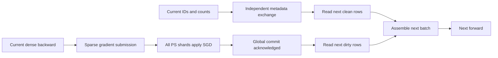

# Exact-step parameter-server pipeline

`read_mode=ps_pipeline` keeps embedding parameters in the PS. A trainer retains
only the consumed batch's GPU rows and transfer buffers. Dense parameters remain
replicated. Every next-step read must observe the preceding global sparse SGD
commit; asynchronous submission does not relax this rule.

## Scheduling

The default path prepares CPU unique IDs and inverse indices, performs an owned
pinned-memory read, runs dense forward/backward, coalesces sparse gradients, and
submits an asynchronous sparse commit. The next lookup waits for that commit.
The final measured step drains pending updates.

With `--ps-pipeline-dependency-split`, an independent Gloo worker exchanges the
current step's global key set. The next batch is partitioned into:

- Clean keys, absent from the current global update set. They can be fetched
  early once the preceding step's read proves the previous commit completed.
- Dirty keys, which are fetched only after every PS shard acknowledges the
  current commit.

The metadata worker never waits for the commit/read worker. One future batch is
prepared, and the final batch does not schedule an unused value read. Owned CPU
transfer buffers survive consumption until their CUDA copies have completed.

`RECSTORE_RDMA_SPLIT_LANES=1` optionally reserves QP0 for commit/control and
remaining QPs for GET. It requires at least two QPs, complete initialization of
legal IDs, an immutable key namespace, and no external writes. It allows clean
reads to overlap commits; it does not authorize dirty reads before the global
gate. Existing asynchronous update/prefetch APIs reject this experimental mode.

## Merged-gradient owner updates

The canonical bit-exact reduction protocol (v3) was removed. Deterministic
rank-local coalescing cannot reproduce every TorchRec rounding operation, and
reproducing it required a per-step reduction-tree reconstruction on both the
client and the PS. The replacement accepts tolerance-level equivalence
instead: each rank packs its pooled merged gradients, the owning GPU computes
`updated = fma(-lr, (v0 + v1) * 0.5, old)` locally, and the result is published
through the v4 exact-replacement wire. Accuracy is checked with loss tolerance
(atol 1e-6 / rtol 1e-5), final-parameter tolerance (atol 1e-6 / rtol 1e-5), and
a bit-exact PS self-repeat; heldout AUC/BCE are supplementary evidence.

Every step still exchanges key counts, including the final step. The exchange
validates step, batch shape and a digest of feature names, offsets and table
types. The `canonical_sparse_ticket` native op builds the local ticket and
feature-major inverse; the NumPy planner remains the reference implementation
and the native path is an explicit per-call opt-in. Stable occurrence grouping
maps feature-major IDs to sample-major pooled gradients through a
deterministic `index_add_`.

The owner plan op routes merged rows to GPUs using the configured real key
hash: it merges both ranks' sorted unique keys and counts, computes the
city-hash ownership, and emits the destination-major permutation, per-key
metadata, and all-to-all splits. The forward variant additionally produces the
KJT-ordered send index and receive reorder used by the unified forward path.
Unlike the removed v3 planner it does not require per-feature occurrence-total
equality, because merged rows carry one gradient per key.

The v4 exact-replacement wire performs no server-side arithmetic. The owning
trainer submits its sorted owned rows; the PS validates bounds, order, key
routing, finiteness and the immutable namespace, then copies the payload bits
into the existing direct D128 rows after the global commit gate. The CUDA
kernel contract (defensive metadata checks, error code, optional gradient
output) is shared by the v2 merged math kernel `recstore_owner_math_v2`.
FMA is fully optional; nothing in the pipeline requires
`RECSTORE_SPARSE_COMMIT_FMA`.

## Wire versions

- v1: coalesced per-rank rows, server-side aggregation, optional divisor.
- v2: sorted per-rank rows with the chunked common-prefix frontier
  (`RECSTORE_SPARSE_COMMIT_SORTED_STREAM=1`).
- v3: canonical bit-exact reduction, removed.
- v4: exact owner replacement, no server-side arithmetic.

## Evidence and acceptance

The November 2026 experiments use authenticated Criteo day0 prefix data,
identical batch order, initialization, FP32 SGD, and unchanged state gates.
The merged owner path passed 1,000-step loss tolerance, final-parameter
tolerance and bit-exact self-repeat gates on the dual-machine benchmark;
measured end-to-end results, failed candidates, input provenance and exact
commands are retained under the separate experiment output directory. No 2x
TorchRec-HBM result is established by this document.
