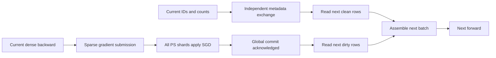

# Exact-step parameter-server pipeline

`read_mode=ps_pipeline` keeps embedding parameters in the PS. A trainer retains
only the consumed batch's GPU rows and transfer buffers. Dense parameters remain
replicated. Every next-step read must observe the preceding global sparse SGD
commit; asynchronous submission does not relax this rule.

## Scheduling

The default path prepares CPU unique IDs and inverse indices, performs an owned
pinned-memory read, runs dense forward/backward, coalesces sparse gradients, and
submits an asynchronous sparse commit. The next lookup waits for that commit.
The final measured step drains pending updates.

With `--ps-pipeline-dependency-split`, an independent Gloo worker exchanges the
current step's global key set. The next batch is partitioned into:

- Clean keys, absent from the current global update set. They can be fetched
  early once the preceding step's read proves the previous commit completed.
- Dirty keys, which are fetched only after every PS shard acknowledges the
  current commit.

The metadata worker never waits for the commit/read worker. One future batch is
prepared, and the final batch does not schedule an unused value read. Owned CPU
transfer buffers survive consumption until their CUDA copies have completed.

`RECSTORE_RDMA_SPLIT_LANES=1` optionally reserves QP0 for commit/control and
remaining QPs for GET. It requires at least two QPs, complete initialization of
legal IDs, an immutable key namespace, and no external writes. It allows clean
reads to overlap commits; it does not authorize dirty reads before the global
gate. Existing asynchronous update/prefetch APIs reject this experimental mode.

## Canonical sparse arithmetic: experimental v3

Deterministic rank-local coalescing does not reproduce every TorchRec rounding
operation. In the validated reference plan, table-wise FBGEMM scales occurrence
gradients before its reduction tree; data-parallel FBGEMM performs the local tree
before DDP's predivision and rank sum. A single local row sum loses the information
needed to reconstruct the table-wise tree across rank boundaries.

`--ps-pipeline-canonical-plan PATH` selects v3 explicitly. `PATH` is a JSON map
from exact table names to `sharding_type` and `compute_kernel`, exported from the
reference plan. Supported pairs are `table_wise/fused` and `data_parallel/dense`.
The runner checks the table set and validated Torch 2.7.1, TorchRec 1.2.0 and
FBGEMM 1.2.0 versions. The current scope is two ranks, CUDA FP32, D128, at most
1024 samples per rank, one ID per feature per sample, and distinct table key
ranges. This is not a general FBGEMM compatibility implementation.

For table-wise tables the client sends complete local CTA roots, serial warp
partials, and the necessary raw suffix when a serial leaf crosses ranks. The PS
reconstructs the original serial additions and tree. For data-parallel tables
each present rank sends its local tree result after predivision. The PS includes
an explicit positive zero for an absent rank and applies one FP32 FMA update.
No approximation, compression, stale read or gradient dropping is introduced.

Every step exchanges key counts, including the final step. The exchange validates
step, batch shape and a digest of feature names, offsets and table types. Stable
occurrence grouping maps feature-major IDs to sample-major pooled gradients.
GPU partials use their own allocation; native asynchronous staging owns that
allocation, its pinned destination and completion event through submission.

The homogeneous-host v3 wire format uses the existing 56-byte header, followed
by 16-byte records `{key, count_rank0, count_rank1, vector_count, table_type,
reserved}`, followed by packed D128 FP32 vectors. A key record never spans
chunks. Routing uses the configured real key hash. Both ranks must agree on
counts and type; exact payload length, vector counts, key order and finite
values are checked. All endpoints require `RECSTORE_SPARSE_COMMIT_FMA=1` and
`divisor=1` for v3. Nonfinite inputs, reconstruction overflow, missing weights or
nonfinite FMA results fail the session.

V3 initially applies whole steps. `RECSTORE_SPARSE_COMMIT_CANONICAL_STREAM=1`
optionally reuses the sorted common-prefix frontier. Prefix updates are not
rolled back on a later malformed packet: the session becomes permanently failed
and must never acknowledge that step or permit a dependent read. V1/v2 remain
available through their original API.

Set `TORCH_EXTENSIONS_DIR` to an experiment-owned directory and `MAX_JOBS=1`
before running v3. The CUDA helper is compiled before training metadata starts.
The default Python planner is a reference implementation. Opt in to
`RECSTORE_PS_CANONICAL_CPP_PLAN=1` to use the integer-only planner registered in
the existing RecStore native module. It preserves the same records, occurrence
positions and GPU tasks; requesting it without the matching native op fails
explicitly. The CUDA arithmetic and wire protocol are unchanged.

`RECSTORE_PS_CANONICAL_CPP_TICKET=1` additionally builds the local ticket and
feature-major inverse in the same native module. Stable byte-radix passes retain
occurrence order for equal keys. The output contains unique keys, counts,
sample-major positions, group starts, table types, and inverse indices. Negative
NumPy strides are copied explicitly before conversion to Torch, including empty
and singleton views. The default NumPy path remains available; an explicit opt-in
without the native op fails instead of silently selecting another path.

`RECSTORE_PS_CANONICAL_SIMD=1` enables AVX2/FMA on supported x86 CPUs, with a
scalar fallback. Vectorization spans independent embedding columns, preserving
each column's reduction tree and FP32 rounding. Integer exponent checks scan
possibly unaligned FP32 payloads for nonfinite values. Every required input,
intermediate result and SGD result is still checked; a complete prefix is
validated before its first parameter write. This switch does not relax update
visibility or authorize asynchronous use of unfinished weights.

## Evidence and acceptance

The November 2 experiment uses authenticated Criteo day0 prefix data, identical
batch order, initialization, FP32 SGD, and unchanged strict state tolerances.
Operator tests cover actual GPU packing, native reconstruction/FMA, actual
FBGEMM, and real two-host TorchRec DDP/NCCL. The first full canonical run also
matched TorchRec-HBM bit for bit over 1,000 steps: all 2,000 rank-local losses,
both ranks' dense parameters and 235,466 touched embedding rows. This validates
the fixed workload and versions above, not arbitrary models or nonfinite
arithmetic. Integer-planner tests compare 1,805 complete plans, including both
ranks of the first 80 real batches; an optimized end-to-end run must still pass
the full-training gate.

The first80 count-only estimate increases v3 commit payload by about 45% versus
current coalesced v2. It reduces traffic relative to sending every occurrence,
but that is a different baseline. Measured end-to-end results, failed candidates,
input provenance and exact commands are retained under the separate experiment
output directory. No 2x TorchRec-HBM result is established by this document.
