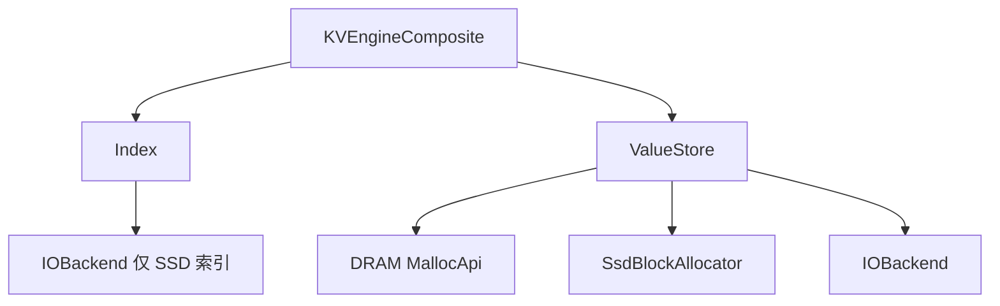

# KVEngineComposite

`KVEngineComposite` 是 RecStore 的**默认** KV 实现：用工厂分别创建 `Index` 与 `ValueStore`，在 `BaseKV` 层完成 Get/Put/BatchGet/BatchPut/BulkLoad 编排。

- 存储层总览：[index.md](./index.md)
- `BaseKV` 与其他 `engine_type`：[basekv.md](./basekv.md)

## 代码入口

| 文件 | 内容 |
|------|------|
| `src/storage/kv_engine/engine_composite.h` | 实现与 `FACTORY_REGISTER` |
| `src/storage/index/` | `Index` 实现 |
| `src/storage/value_store/` | `ValueStore` 实现 |
| `src/storage/io_backend/` | `IOBackend`（SSD value / SSD 索引） |
| `src/memory/allocators/` | DRAM `MallocApi` |
| `src/storage/allocator/ssd/` | SSD slab / buddy |

## 内部分层



**写路径**：`ValueStore::AllocAndWrite` → `Index::Put`（得到旧 handle）→ `ValueStore::Retire(old)`。

**读路径**：`Index::Get` / `BatchGet` → `DirectPtr` 或 `Read` / `BatchRead`。

## 配置骨架

```json
{
  "engine_type": "KVEngineComposite",
  "capacity": 1000000,
  "index": { "type": "DRAM_PET_HASH" },
  "value": {
    "type": "DRAM_VALUE_STORE",
    "default_value_size_hint": 512,
    "path": "/dev/shm/recstore_kv/value",
    "dram_allocator": {
      "type": "CONCURRENT_SLAB_MEMORY_POOL",
      "capacity_bytes": 512000000
    }
  }
}
```

省略 `engine_type` 时，`ResolveEngine` 仍解析为 `KVEngineComposite`。

### 顶层字段

| 字段 | 说明 |
|------|------|
| `capacity` | 必填；索引容量估计，`DRAM_PET_HASH` 用于分配表 |
| `index` | 必填；至少 `index.type` |
| `value` | 必填；至少 `value.type`、`value.default_value_size_hint`，并按类型提供 allocator / path |

字段校验分布在各组件构造函数（如 `DramValueStore` 要求非空 `value.path` 与 `dram_allocator`）。集成测试见 `KVEngineCompositeConfigTest`（`src/test/test_kvengine.cpp`）。

---

## Index（`index.type`）

工厂：`Factory<Index, const BaseKVConfig&>`，注册于 `src/storage/index/`。

| `index.type` | 实现类 | 额外配置 | 说明 |
|--------------|--------|----------|------|
| `DRAM_EXTENDIBLE_HASH` | `DramExtendibleHashIndex` | — | 可扩展 hash；别名 `DRAM` |
| `DRAM_UNORDERED_MAP` | `DramUnorderedMapIndex` | — | `unordered_map` + 读写锁 |
| `DRAM_PET_HASH` | `DramPetHashIndex` | 依赖 `capacity` | PetHash，BatchGet 带 prefetch hint |
| `SSD_EXTENDIBLE_HASH` | `SsdExtendibleHashIndex` | `index.path`、`index.io` | CCEH；别名 `SSD` |
| `SSD` | 同上 | 同上 | 与 `SSD_EXTENDIBLE_HASH` 相同 |

SSD 索引创建 `IOBackend` 前的配置映射：

| 嵌套字段 | 映射到 `BaseKVConfig` |
|----------|------------------------|
| `index.path` | `file_path` |
| `index.io.type` | `io_backend_type`（默认 `IOURING`） |
| `index.io.queue_depth` | `queue_cnt` |
| `index.io.base_offset_bytes / PAGE_SIZE` | `page_id_offset` |

实践上 SSD 索引常与 `SSD_VALUE_STORE` 联调（见 `test_kvengine` 笛卡尔用例对 SSD 组合的 skip 规则）；DRAM 索引与三种 value store 均可组合。

---

## ValueStore（`value.type`）

工厂：`Factory<ValueStore, const BaseKVConfig&>`。

| `value.type` | 实现类 | 说明 |
|--------------|--------|------|
| `DRAM_VALUE_STORE` | `DramValueStore` | 需非空 `value.path`、`value.dram_allocator` |
| `SSD_VALUE_STORE` | `SsdValueStore` | 需非空 `value.path`、`value.ssd_allocator`（含 `io`） |
| `SSD_STATIC_LAYOUT_VALUE_STORE` | `SsdStaticLayoutValueStore` | 固定 Bandana/MaxEmbed 布局，见下文 |
| `TIERED_VALUE_STORE` | `HybridValueStore` | 需 `dram_allocator` + `ssd_allocator`；无顶层 `value.path` |

### 组合与字段约束

| Index（常见） | `DRAM_VALUE_STORE` | `SSD_VALUE_STORE` | `TIERED_VALUE_STORE` |
|---------------|:------------------:|:-----------------:|:--------------------:|
| DRAM 三类 | 支持 | 支持 | 支持 |
| `SSD` / `SSD_EXTENDIBLE_HASH` | 不推荐 | 支持（测试重点） | 需自行验证 |

| `value.type` | 字段约束 |
|--------------|-------------|
| `DRAM_VALUE_STORE` | `dram_allocator` 必填；不接受 `ssd_allocator` |
| `SSD_VALUE_STORE` | `ssd_allocator` 必填；不接受 `dram_allocator`；文件路径为 `value.path` |
| `TIERED_VALUE_STORE` | 两者必填；SSD 路径在 `ssd_allocator.path`；DRAM 路径可选 `dram_allocator.path`（常为 `/dev/shm/...`） |

**Tiering**：默认按 DRAM 高水位优先安放，超出部分进入 SSD。`lru` 提供 SSD 读缓存，`clock` 支持冷热交换和可选的后台回写，`adaptive` 按工作集估计选择策略，见[分层安放与读缓存](#分层安放与读缓存)。

---

## IOBackend（`*.io.type`）

| `io.type` | 实现 |
|-----------|------|
| `IOURING` | `IoUringBackend` |
| `SPDK` | `SpdkBackend` |

`SsdValueStore`（及 tiered 的 SSD 子配置）映射关系：

| 嵌套字段 | `IOBackend` 字段 |
|----------|------------------|
| `value.path` 或 `ssd_allocator.path` | `file_path` |
| `io.queue_depth` | `queue_cnt` |
| `io.base_offset_bytes / PAGE_SIZE` | `page_id_offset` |
| `io.type` | 工厂名 |

新后端需链接进 `force_link`（见 `kv_engine_register.cc`）。

---

## DRAM Allocator（`value.dram_allocator.type`）

`Factory<MallocApi, const std::string&, int64, const std::string&>`。仓库默认配置使用 **`CONCURRENT_SLAB_MEMORY_POOL`**；若省略 `dram_allocator.type`，`DramValueStore` 在代码中会回退到 **`R2_SLAB`**。

| `type` | 实现 | 别名 |
|--------|------|------|
| `PERSIST_LOOP_SLAB` | `PersistLoopShmMalloc` | `PersistLoopShmMalloc` |
| `R2_SLAB` | `R2alloc` | `R2ShmMalloc` |
| `CONCURRENT_SLAB_MEMORY_POOL` | `ConcurrentSlabMemoryPoolMalloc` | — |
| `PERSIST_MEMORY_POOL` | `PersistMemoryPoolMalloc` | — |

必填：`capacity_bytes`。遗留别名见 `memory/allocators/allocator_factory.h`（如 `PERSIST_LOOP_SHM_MALLOC`）。

`CONCURRENT_SLAB_MEMORY_POOL` 支持可选 `size_classes`（正整数数组，单位字节）。尺寸类含 8 字节元数据头，
请求 `r` 由第一个满足 `class >= 8 + r` 的档位承接；默认
`[8+32, 8+64, 8+80, 8+128, 8+272, 8+512, 8+1024]`，其中 `8 + dim*4` 两档服务 dim 20 / dim 68 的行，
避免被抬到 136 / 520。类表最大档决定可支持的 value 尺寸上限（默认 1024 字节），更宽的行需要显式列进
`size_classes`。其他 DRAM 分配器没有注册带 `size_classes` 的工厂，配置该字段会抛 `std::invalid_argument`。

---

## SSD Allocator（`value.ssd_allocator.type`）

`SsdValueStore` 内联构造；默认 **`SSD_SLAB`**。静态 Bandana/MaxEmbed 布局不使用这两个 allocator。

| `type` | 实现 | 主要字段 |
|--------|------|----------|
| `SSD_SLAB` | `SsdSlabAllocator` | `capacity_bytes`；可选 `size_classes`（默认 128…4096）；`base_offset_bytes` |
| `SSD_BUDDY` | `SsdBuddyAllocator` | `capacity_bytes`；`min_block_size` / `max_block_size`；`base_offset_bytes` |

均需嵌套 `io` 对象。`plain` 是省略 `value.ssd_layout` 或显式 `"strategy": "plain"` 的现有 `SSD_VALUE_STORE`。

## 静态 SSD 布局

`SSD_STATIC_LAYOUT_VALUE_STORE` 直接保存 `key -> [(page, offset), ...]`。handle 是 `key + 1`，`0` 仍表示缺失；默认分层模式在 SSD handle 上加最高位，CLOCK 则使用独立逻辑 handle。key 必须小于 `2^63-1`。

| `value.ssd_layout.strategy` | 含义 |
|-----------------------------|------|
| `bandana` | 每个 key 一个固定页槽 |
| `maxembed` | 每个 key 一个 primary 槽，外加预算内的副本页 |

离线命令是 `recstore_ssd_layout partition|replicate|shrink|inspect`。`bandana` 只跑 partition；`maxembed` 在 partition 之后跑 replicate，需要更低副本率时再 shrink。运行时加载 artifact，并要求 `strategy` 和 `default_value_size_hint` 与文件一致。输入和 artifact 字节布局见 [ssd_layout.md](https://github.com/RecStore/RecStore/blob/main/src/storage/ssd_layout/ssd_layout.md)。

固定槽位不会 `Alloc` 或 `Free`。更新覆盖该 key 的全部副本；mapping 中没有的 key、变长 value 会直接失败。换 strategy 或 artifact 不能热切换，必须用空 engine 重新 `BulkLoad` 或 `LoadCheckpoint`。

Checkpoint v3 在原 metadata 之外保存 strategy 和 artifact checksum。v2 checkpoint 只能恢复到 plain engine；identity 不一致时拒绝加载，不会静默退回 plain。

`TIERED_VALUE_STORE` 可以把静态 store 当作 SSD 子 store。DRAM 选择仍是现有高水位：`dram_bytes_reserved + size <= capacity * high_watermark_ratio`。

## 分层安放与读缓存

通过 `value.tiering.cache_policy` 选择策略：

| 策略 | 行为 |
|------|------|
| `none`（默认） | 按 DRAM 高水位安放，超出部分进入 SSD，不做冷热交换 |
| `lru` | 预留部分 DRAM 缓存 SSD 读结果，不淘汰最初安放在 DRAM 的 value |
| `clock` | DRAM 与 SSD 按访问热度交换，共享整个 DRAM 高水位预算 |
| `adaptive` | 根据 `expected_dram_bytes` 选择直接 DRAM、LRU 或 CLOCK |

字段位于 `value.tiering`：

| 字段 | 默认 | 含义 |
|------|------|------|
| `high_watermark_ratio` | `0.85` | DRAM 安放水位 |
| `cache_budget_ratio` | `0.05` | LRU 缓存预留比例，范围 `(0, 1]`；CLOCK 不使用此预留 |
| `cache_shards` | `16` | 缓存或 CLOCK 分片数 |
| `promote_min_misses` | `2` | SSD value 达到晋升条件所需的成功读取次数 |
| `expected_dram_bytes` | `0` | 完整工作集经 allocator 档位取整后的 value 字节数；`0` 表示未知 |
| `retain_backing_copies` | `true` | CLOCK 晋升后保留 SSD 副本；仅 plain 布局可关闭 |
| `clock_frequency_admission` | `false` | 使用共同衰减周期比较 DRAM 与 SSD 数据的访问频率 |
| `clock_cost_aware` | `false` | 在热度相同时，优先淘汰已有有效 SSD 副本、无需回写的 value |
| `clock_async_exchange` | `false` | 由后台线程执行 CLOCK 交换与回写 |
| `clock_exchange_queue_entries` | `256` | 后台交换中等待和执行的候选总数上限 |
| `clock_exchange_queue_bytes` | `4194304` | 上述候选的 value 缓冲区总字节上限 |

LRU 的缓存预算从 DRAM 容量中预扣，主安放上限为 `high_watermark_ratio * (capacity - budget)`。缓存和主安放共用容量，写入同步更新缓存，释放 value 时使缓存失效。若正数 `expected_dram_bytes` 不超过原始 DRAM 水位，则不预留缓存，实际策略为 `none`。

`adaptive` 在构造时选择策略：工作集能放入 DRAM 时走直接读路径；溢出量不超过估计工作集的 0.1% 时使用 LRU，按溢出量预留缓存；其余情况使用 CLOCK。工作集未知或会继续增长时应保留 `expected_dram_bytes=0`，避免低估后停留在不做交换的策略。

### CLOCK 冷热交换

SSD value 达到晋升门槛后，CLOCK 尝试复用同一分片中较冷 value 的 DRAM 槽位，每次最多检查 64 个候选。逻辑 handle 在交换期间保持不变。批量 SSD 读成功后先记录访问需求，再尝试晋升；晋升锁繁忙不会丢失已完成读取的需求，失败的 I/O 不获得晋升计数。

默认保留晋升 value 的 SSD 副本。未修改的副本被淘汰时无需回写；初始 DRAM value 或修改过的 value 则先写入 SSD，再复用 DRAM 槽位。回写失败时保留原安放。关闭 `retain_backing_copies` 可在晋升后释放 SSD 槽位，但之后每次淘汰都要重新写入。

`clock_cost_aware` 先比较热度，再比较是否需要回写，不会为节省写入而优先淘汰更热的数据。`clock_frequency_admission` 让两层的访问频率按相同周期衰减，候选需有足够的频率优势才交换；它与成本策略独立，均需按实际负载选择。

启用 `clock_async_exchange` 后，前台将候选 value 放入有界队列，后台检查 handle 和写入版本后执行交换。队列满或锁繁忙时跳过本次晋升，后续访问可重试；SSD 需求读取本身仍需等待 I/O。队列两个上限必须为正数，包含正在执行的候选，且额外占用的缓冲区不计入 resident value 预算。

CLOCK 的 DRAM 命中使用快照与读取者保护，批量路径预取元数据并每 64 行发布一次读取状态；写入、释放和淘汰会等待相关读取者结束。此模式不提供直接 value 指针或 RDMA 行地址，调用方使用复制路径。

### 初始安放与基准统计

`benchmark_kv_engine --load_order=PATH` 接受覆盖 `[0, record_count)` 的无头二进制 uint64 排列，按历史热度从高到低加载。初始安放不固定后续驻留位置，CLOCK 仍可在线交换；生成顺序时只使用历史请求，不使用评估窗口的数据。

基准程序兼容 `--tiering_cache_policy`、`--tiering_cache_budget_ratio`、`--tiering_promote_min_misses` 及对应的 `--tiered_cache_policy`、`--tiered_cache_budget_ratio`、`--tiered_cache_promote_min_misses`。同一参数的两种名称同时指定不同值会报错。`--tiering_cache_shards` 控制分片数；CLOCK 扩展参数使用 `--tiered_clock_*`。

真实访问回放使用 `--distribution=trace --access_trace=PATH`，可用 `--warmup_access_trace=PATH` 指定独立预热窗口。trace 为无头二进制 uint64 key 流，每个工作线程按顺序循环回放自己的连续片段。

比较安放策略时保持相同的 value DRAM 预算，并单独记录元数据、临时缓冲区和 RSS。`tiered_dram_live_allocs`、`tiered_ssd_live_allocs` 表示当前主驻留数量，SSD 副本不算额外驻留；`tiered_clock_metadata_bytes` 仅统计元数据数组。`tiered_clock_promotions` 表示完成的晋升次数，`tiered_clock_writebacks` 表示成功回写的 value 次数。

异步交换基准在阶段边界等待队列排空，`YCSB_RUN_MAINTENANCE` 同时给出排空耗时和包含该耗时的吞吐。大批量读取可合并相邻页并复用其他批次尚未完成的页读取，但也会增加临时内存；延迟直方图溢出时，饱和的分位数桶只能作为下界。

---

## 配置样例

**DRAM + DRAM（仓库默认组合）**

与上面的配置骨架相同。

**DRAM + SSD**

```json
{
  "capacity": 1000000,
  "index": { "type": "DRAM_UNORDERED_MAP" },
  "value": {
    "type": "SSD_VALUE_STORE",
    "default_value_size_hint": 512,
    "path": "/data/recstore/value_pages.db",
    "ssd_allocator": {
      "type": "SSD_BUDDY",
      "capacity_bytes": 512000000,
      "min_block_size": 128,
      "max_block_size": 65536,
      "io": {
        "type": "IOURING",
        "queue_depth": 512,
        "base_offset_bytes": 4096
      }
    }
  }
}
```

**DRAM + tiered**

```json
{
  "capacity": 1000000,
  "index": { "type": "DRAM_EXTENDIBLE_HASH" },
  "value": {
    "type": "TIERED_VALUE_STORE",
    "default_value_size_hint": 512,
    "dram_allocator": {
      "type": "PERSIST_LOOP_SLAB",
      "capacity_bytes": 128000000,
      "path": "/dev/shm/recstore_data/tiered_dram"
    },
    "ssd_allocator": {
      "type": "SSD_BUDDY",
      "capacity_bytes": 512000000,
      "path": "/data/recstore/tiered_value_pages.db",
      "min_block_size": 128,
      "max_block_size": 65536,
      "io": {
        "type": "IOURING",
        "queue_depth": 512,
        "base_offset_bytes": 4096
      }
    },
    "tiering": {
      "high_watermark_ratio": 0.85,
      "cache_policy": "none",
      "cache_budget_ratio": 0.05,
      "promote_min_misses": 2,
      "cache_shards": 16
    }
  }
}
```

**SSD index + SSD value**

```json
{
  "capacity": 1000000,
  "index": {
    "type": "SSD_EXTENDIBLE_HASH",
    "path": "/data/recstore/index_pages.db",
    "io": {
      "type": "IOURING",
      "queue_depth": 512,
      "base_offset_bytes": 0
    }
  },
  "value": {
    "type": "SSD_VALUE_STORE",
    "default_value_size_hint": 512,
    "path": "/data/recstore/value_pages.db",
    "ssd_allocator": {
      "type": "SSD_SLAB",
      "capacity_bytes": 512000000,
      "size_classes": [128, 256, 512, 1024, 4096],
      "io": {
        "type": "IOURING",
        "queue_depth": 512,
        "base_offset_bytes": 4096
      }
    }
  }
}
```

---

## 扩展指南

[新增 Index、ValueStore 与 IOBackend](../dev/feature/storage.md)。
