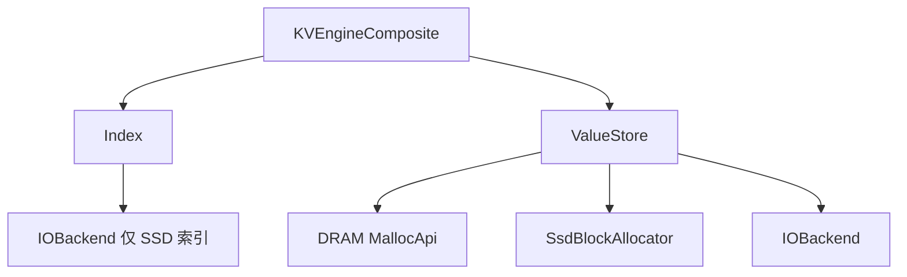

# KVEngineComposite

`KVEngineComposite` 是 RecStore 的**默认** KV 实现：用工厂分别创建 `Index` 与 `ValueStore`，在 `BaseKV` 层完成 Get/Put/BatchGet/BatchPut/BulkLoad 编排。

- 存储层总览：[index.md](./index.md)
- `BaseKV` 与其他 `engine_type`：[basekv.md](./basekv.md)

## 代码入口

| 文件 | 内容 |
|------|------|
| `src/storage/kv_engine/engine_composite.h` | 实现与 `FACTORY_REGISTER` |
| `src/storage/index/` | `Index` 实现 |
| `src/storage/value_store/` | `ValueStore` 实现 |
| `src/storage/io_backend/` | `IOBackend`（SSD value / SSD 索引） |
| `src/memory/allocators/` | DRAM `MallocApi` |
| `src/storage/allocator/ssd/` | SSD slab / buddy |

## 内部分层



**写路径**：`ValueStore::AllocAndWrite` → `Index::Put`（得到旧 handle）→ `ValueStore::Retire(old)`。

**读路径**：`Index::Get` / `BatchGet` → `DirectPtr` 或 `Read` / `BatchRead`。

## 配置骨架

```json
{
  "engine_type": "KVEngineComposite",
  "capacity": 1000000,
  "index": { "type": "DRAM_PET_HASH" },
  "value": {
    "type": "DRAM_VALUE_STORE",
    "default_value_size_hint": 512,
    "path": "/dev/shm/recstore_kv/value",
    "dram_allocator": {
      "type": "CONCURRENT_SLAB_MEMORY_POOL",
      "capacity_bytes": 512000000
    }
  }
}
```

省略 `engine_type` 时，`ResolveEngine` 仍解析为 `KVEngineComposite`。

### 顶层字段

| 字段 | 说明 |
|------|------|
| `capacity` | 必填；索引容量估计，`DRAM_PET_HASH` 用于分配表 |
| `index` | 必填；至少 `index.type` |
| `value` | 必填；至少 `value.type`、`value.default_value_size_hint`，并按类型提供 allocator / path |

字段校验分布在各组件构造函数（如 `DramValueStore` 要求非空 `value.path` 与 `dram_allocator`）。集成测试见 `KVEngineCompositeConfigTest`（`src/test/test_kvengine.cpp`）。

---

## Index（`index.type`）

工厂：`Factory<Index, const BaseKVConfig&>`，注册于 `src/storage/index/`。

| `index.type` | 实现类 | 额外配置 | 说明 |
|--------------|--------|----------|------|
| `DRAM_EXTENDIBLE_HASH` | `DramExtendibleHashIndex` | — | 可扩展 hash；别名 `DRAM` |
| `DRAM_UNORDERED_MAP` | `DramUnorderedMapIndex` | — | `unordered_map` + 读写锁 |
| `DRAM_PET_HASH` | `DramPetHashIndex` | 依赖 `capacity` | PetHash，BatchGet 带 prefetch hint |
| `SSD_EXTENDIBLE_HASH` | `SsdExtendibleHashIndex` | `index.path`、`index.io` | CCEH；别名 `SSD` |
| `SSD` | 同上 | 同上 | 与 `SSD_EXTENDIBLE_HASH` 相同 |

SSD 索引创建 `IOBackend` 前的配置映射：

| 嵌套字段 | 映射到 `BaseKVConfig` |
|----------|------------------------|
| `index.path` | `file_path` |
| `index.io.type` | `io_backend_type`（默认 `IOURING`） |
| `index.io.queue_depth` | `queue_cnt` |
| `index.io.base_offset_bytes / PAGE_SIZE` | `page_id_offset` |

实践上 SSD 索引常与 `SSD_VALUE_STORE` 联调（见 `test_kvengine` 笛卡尔用例对 SSD 组合的 skip 规则）；DRAM 索引与三种 value store 均可组合。

---

## ValueStore（`value.type`）

工厂：`Factory<ValueStore, const BaseKVConfig&>`。

| `value.type` | 实现类 | 说明 |
|--------------|--------|------|
| `DRAM_VALUE_STORE` | `DramValueStore` | 需非空 `value.path`、`value.dram_allocator` |
| `SSD_VALUE_STORE` | `SsdValueStore` | 需非空 `value.path`、`value.ssd_allocator`（含 `io`） |
| `SSD_STATIC_LAYOUT_VALUE_STORE` | `SsdStaticLayoutValueStore` | 固定 Bandana/MaxEmbed 布局，见下文 |
| `TIERED_VALUE_STORE` | `HybridValueStore` | 需 `dram_allocator` + `ssd_allocator`；无顶层 `value.path` |

### 组合与字段约束

| Index（常见） | `DRAM_VALUE_STORE` | `SSD_VALUE_STORE` | `TIERED_VALUE_STORE` |
|---------------|:------------------:|:-----------------:|:--------------------:|
| DRAM 三类 | 支持 | 支持 | 支持 |
| `SSD` / `SSD_EXTENDIBLE_HASH` | 不推荐 | 支持（测试重点） | 需自行验证 |

| `value.type` | 字段约束 |
|--------------|-------------|
| `DRAM_VALUE_STORE` | `dram_allocator` 必填；不接受 `ssd_allocator` |
| `SSD_VALUE_STORE` | `ssd_allocator` 必填；不接受 `dram_allocator`；文件路径为 `value.path` |
| `TIERED_VALUE_STORE` | 两者必填；SSD 路径在 `ssd_allocator.path`；DRAM 路径可选 `dram_allocator.path`（常为 `/dev/shm/...`） |

**Tiering**：`HybridValueStore` 在 `dram_bytes_reserved + size <= capacity * high_watermark_ratio`（默认 `0.85`）时优先 DRAM，否则 SSD；handle 最高位标记介质。**没有后台冷热迁移线程**；`tiering.cache_policy=lru` 提供 SSD 读缓存，`clock` 在同步读路径交换冷 DRAM 和热 SSD 数据，见下文。

---

## IOBackend（`*.io.type`）

| `io.type` | 实现 |
|-----------|------|
| `IOURING` | `IoUringBackend` |
| `SPDK` | `SpdkBackend` |

`SsdValueStore`（及 tiered 的 SSD 子配置）映射关系：

| 嵌套字段 | `IOBackend` 字段 |
|----------|------------------|
| `value.path` 或 `ssd_allocator.path` | `file_path` |
| `io.queue_depth` | `queue_cnt` |
| `io.base_offset_bytes / PAGE_SIZE` | `page_id_offset` |
| `io.type` | 工厂名 |

新后端需链接进 `force_link`（见 `kv_engine_register.cc`）。

---

## DRAM Allocator（`value.dram_allocator.type`）

`Factory<MallocApi, const std::string&, int64, const std::string&>`。仓库默认配置使用 **`CONCURRENT_SLAB_MEMORY_POOL`**；若省略 `dram_allocator.type`，`DramValueStore` 在代码中会回退到 **`R2_SLAB`**。

| `type` | 实现 | 别名 |
|--------|------|------|
| `PERSIST_LOOP_SLAB` | `PersistLoopShmMalloc` | `PersistLoopShmMalloc` |
| `R2_SLAB` | `R2alloc` | `R2ShmMalloc` |
| `CONCURRENT_SLAB_MEMORY_POOL` | `ConcurrentSlabMemoryPoolMalloc` | — |
| `PERSIST_MEMORY_POOL` | `PersistMemoryPoolMalloc` | — |

必填：`capacity_bytes`。遗留别名见 `memory/allocators/allocator_factory.h`（如 `PERSIST_LOOP_SHM_MALLOC`）。

`CONCURRENT_SLAB_MEMORY_POOL` 支持可选 `size_classes`（正整数数组，单位字节）。尺寸类含 8 字节元数据头，
请求 `r` 由第一个满足 `class >= 8 + r` 的档位承接；默认
`[8+32, 8+64, 8+80, 8+128, 8+272, 8+512, 8+1024]`，其中 `8 + dim*4` 两档服务 dim 20 / dim 68 的行，
避免被抬到 136 / 520。类表最大档决定可支持的 value 尺寸上限（默认 1024 字节），更宽的行需要显式列进
`size_classes`。其他 DRAM 分配器没有注册带 `size_classes` 的工厂，配置该字段会抛 `std::invalid_argument`。

---

## SSD Allocator（`value.ssd_allocator.type`）

`SsdValueStore` 内联构造；默认 **`SSD_SLAB`**。静态 Bandana/MaxEmbed 布局不使用这两个 allocator。

| `type` | 实现 | 主要字段 |
|--------|------|----------|
| `SSD_SLAB` | `SsdSlabAllocator` | `capacity_bytes`；可选 `size_classes`（默认 128…4096）；`base_offset_bytes` |
| `SSD_BUDDY` | `SsdBuddyAllocator` | `capacity_bytes`；`min_block_size` / `max_block_size`；`base_offset_bytes` |

均需嵌套 `io` 对象。`plain` 是省略 `value.ssd_layout` 或显式 `"strategy": "plain"` 的现有 `SSD_VALUE_STORE`。

## 静态 SSD 布局

`SSD_STATIC_LAYOUT_VALUE_STORE` 直接保存 `key -> [(page, offset), ...]`。handle 是 `key + 1`，`0` 仍表示缺失；`TIERED_VALUE_STORE` 在 SSD 层继续加最高位。key 必须小于 `2^63-1`。

| `value.ssd_layout.strategy` | 含义 |
|-----------------------------|------|
| `bandana` | 每个 key 一个固定页槽 |
| `maxembed` | 每个 key 一个 primary 槽，外加预算内的副本页 |

离线命令是 `recstore_ssd_layout partition|replicate|shrink|inspect`。`bandana` 只跑 partition；`maxembed` 在 partition 之后跑 replicate，需要更低副本率时再 shrink。运行时加载 artifact，并要求 `strategy` 和 `default_value_size_hint` 与文件一致。输入和 artifact 字节布局见 [ssd_layout.md](https://github.com/RecStore/RecStore/blob/main/src/storage/ssd_layout/ssd_layout.md)。

固定槽位不会 `Alloc` 或 `Free`。更新覆盖该 key 的全部副本；mapping 中没有的 key、变长 value 会直接失败。换 strategy 或 artifact 不能热切换，必须用空 engine 重新 `BulkLoad` 或 `LoadCheckpoint`。

Checkpoint v3 在原 metadata 之外保存 strategy 和 artifact checksum。v2 checkpoint 只能恢复到 plain engine；identity 不一致时拒绝加载，不会静默退回 plain。

`TIERED_VALUE_STORE` 可以把静态 store 当作 SSD 子 store。DRAM 选择仍是现有高水位：`dram_bytes_reserved + size <= capacity * high_watermark_ratio`。

读缓存通过 `tiering.cache_policy` 打开，默认 `none`（关闭）。设为 `lru`（大小写不敏感）后：

| 字段 | 默认 | 含义 |
|------|------|------|
| `cache_budget_ratio` | `0.05` | 预留为读缓存的 DRAM 比例，范围 `(0, 1]` |
| `promote_min_misses` | `2` | 同一 key 连续 miss 多少次后，读完成时把 SSD value 提升进缓存 |
| `cache_shards` | `16` | 缓存分片数，按 key 散列 |
| `expected_dram_bytes` | `0` | Optional load-time working-set estimate in DRAM slot bytes, including size-class rounding. Zero means unknown. |

缓存预算是**预扣**的：打开后主放置上限变成 `high_watermark * (capacity - budget)`，主放置与缓存共享同一份 DRAM 水位，不是额外内存。提升发生在读完成后（同步），只缓存从 SSD 读到的 value；写会同步更新缓存里的值（`WriteThrough`），`Free` 会让该 key 的缓存失效。`Statistics` 输出 `tiered_cache_*` 计数，其中 `tiered_cache_stale_promotions` 表示因并发写而被拒绝的提升次数。

When a positive `expected_dram_bytes` fits under the original DRAM watermark,
the store skips cache reservation and reports `tiered_cache_policy=none`.
This decision is made before loading, so enabling the cache does not displace
an otherwise fitting working set onto SSD. Omit the estimate for unknown or
growing datasets. Underestimating it still permits SSD spill, but does not
activate a cache later. The estimate uses the same slot-capacity accounting as
primary placement; allocator headers and index/cache metadata are additional
memory costs, covered separately by capacity planning and watermark headroom.

For read-heavy workloads with little DRAM, measure `cache_budget_ratio` instead
of assuming 0.05 is optimal. At 1.0, every primary value goes to SSD and all
DRAM allowed by the watermark is available for the read cache. Writes remain
write-through, so a pure-read improvement does not imply a training speedup.
`tools/benchmarks/run_tiered_cache_sweep.py` runs a fixed-capacity budget sweep
with warmup, scrambled Zipfian keys, value checks, counter deltas and repeat
medians. Specify `--dram-slot-bytes` from the actual allocator class, and use a
fresh timestamped `--output-dir` plus an explicit `--ssd-root`. Run the normal
Release build, correctness tests and benchmark process cleanup first.

### DRAM/SSD exchange with CLOCK

Set `value.tiering.cache_policy` to `clock` to enable actual placement changes:

```json
"tiering": {
  "cache_policy": "clock",
  "high_watermark_ratio": 0.85,
  "cache_shards": 16,
  "promote_min_misses": 2
}
```

CLOCK shares the whole DRAM watermark with initial placement. It does not
reserve `cache_budget_ratio`, and `expected_dram_bytes` does not disable it.
An SSD value becomes eligible after `promote_min_misses` reads. If DRAM is
full, CLOCK selects a colder resident in the same shard and reuses its DRAM
slot. This is demand-driven eviction: there is no proactive demotion thread.
A promoted value retains its SSD backing copy. Evicting an unchanged copy
issues no SSD write; the first eviction of an initial DRAM value, or eviction
after a DRAM update, writes the current value before reusing the slot.
Failed writeback leaves the original placements intact and the foreground
SSD read usable. SSD capacity must accommodate retained backing copies; a
plain allocator also needs space for a victim with no backing copy yet.

For plain SSD layouts, `tiering.retain_backing_copies=false` instead frees a
hot value's SSD slot after its DRAM promotion commits. Every later eviction
writes the resident value again. This keeps the cold set in fewer allocated
SSD slots, which can reduce page amplification in large read batches, but
increases write traffic. The default remains `true`; static layouts require
it. The benchmark flag is `--tiered_retain_backing_copies=false`, and
`tiered_clock_retain_backing_copies` reports the effective setting. Failed
writeback never releases the source SSD copy.

`tiering.clock_frequency_admission` defaults to `false`, preserving the original
CLOCK policy: one in 16 DRAM fast-path hits adds 16 heat credits, SSD misses add
one, and the CLOCK scanner halves resident heat when it gives a second chance
or rejects a candidate. This keeps the original sampled read path.

Set `tiering.clock_frequency_admission=true` (benchmark flag
`--tiered_clock_frequency_admission=true`) to enable shared-epoch frequency
admission. `tiered_clock_frequency_admission` reports the effective setting.
In this mode, DRAM fast-path hits add one saturating frequency credit while the
aged frequency is below 64. At 64 or above, approximately one hit in 16 adds 16 credits,
selected by the upper bits of a per-reader Weyl sequence. Low-frequency residents
return to exact counting after aging; slow reads, including SSD misses, always
add one credit. Every hit still sets the reference bit, and every read contributes
to the access clock independently of frequency sampling. Both tiers age credits
in the same access-count epochs; rejected admission scans do not reduce resident
frequency. Readers publish their access counts in groups of 1024, and an epoch
spans approximately four reads per allocated metadata slot (at least 1024 reads).
A candidate needs a frequency advantage of at least
`max(1, floor(resident_frequency / 4))` credits; equal frequencies do not trigger exchange.
After the minimum-miss gate, one recent SSD credit can replace an unused resident
even when earlier miss credits have aged out. This mode protects resident
frequency from repeated rejected candidates, but reduced throughput in the
measured Criteo workload, so it remains opt-in. Compare both modes on the intended
trace; more stable frequency estimates do not guarantee higher throughput.

In either mode, at most 64 candidates are examined per promotion; the victim's slot must fit the
incoming value. Logical handles remain stable across exchange and keyed
updates, with generation checks rejecting stale handles after metadata reuse.

`tiering.promote_min_misses` (default 2) controls admission. Raising it reduces
replacement work but delays adaptation to a new hot set. The storage benchmark
exposes it as `--tiered_cache_promote_min_misses`; compare throughput and SSD
misses on the intended trace before choosing a larger value.

`tiering.clock_cost_aware=true` selects the lowest-heat eligible resident and
prefers a clean SSD backing copy only when heat is equal. The search examines at
most 64 candidates and retains the existing heat, capacity, and lock checks;
a zero-heat clean candidate ends the scan because neither score can improve.
After finding the first eligible victim, further cost comparisons only read other
residents' heat and reference bits; they do not accelerate CLOCK aging. The CLOCK
hand resumes after the selected victim so lookahead does not repeatedly favor
the same ring positions.
Every promotion still requires `promote_min_misses` misses since the previous
promotion or eviction. Write cost does not override this gate or the heat ranking:
repeatedly evicting hotter clean values can trap a new hot set in a small clean
pool while unused dirty values retain DRAM capacity. Historical initial placement
does not pin keys in DRAM. Cost here means whether an actual SSD write or
read-modify-write is required, not a fitted latency model. This option defaults
to `false` and is independent of frequency admission.

`tiering.clock_async_exchange=true` moves eligible exchanges to one background
worker. The foreground copies the fetched value into a bounded candidate queue
and returns without waiting for the candidate's writeback. The worker owns its
locks and value buffers, checks the logical handle generation and write version,
and groups up to 64 candidates for batched writeback. A full queue, a duplicate
candidate, or lock contention can skip that promotion; the read still returns
its fetched data. A later access can retry. Writes and frees invalidate stale
candidates, and recoverable writeback failures leave the authoritative values in
their old tiers. Destruction joins the worker before releasing either value store.

The queue defaults to 256 candidates and 4 MiB of candidate payload, configured
with `clock_exchange_queue_entries` and `clock_exchange_queue_bytes`. Both limits
include queued and active candidates and must be positive. Queue bookkeeping
and string allocation overhead are additional to the payload limit, bounded by
the candidate count. The value DRAM budget is unchanged. Asynchronous exchange
defaults to `false`; it removes exchange writeback from the foreground path, but
single-key demand reads still wait for SSD completion and retain the existing
value-lock semantics. Benchmark flags use the `--tiered_` prefix for these four
settings. Report these modes separately from synchronous CLOCK. The benchmark
waits for queued exchanges at phase boundaries, outside request timing, and emits
`YCSB_RUN_MAINTENANCE` with the drain duration and throughput including that drain.
Use both throughput measures so outstanding writeback cannot hide deferred work.
`tiered_clock_exchange_completed` counts processed jobs, including stale or
rejected candidates; use `tiered_clock_promotions` to count completed promotions.

CLOCK lifetime counters are aggregated per reader, including readers that have
exited, instead of allocating counters for every key. Legacy resident heat samples
mixed per-reader counters at approximately one hit in sixteen, avoiding the fixed
position bias of a low-bit mask on periodic batches. Fast batch readers publish
hit counts once per protected section of at most 64 rows. Flat batch reads
prefetch the section's stable metadata addresses before checking and copying rows;
handle, size, and publication checks still guard every copy. The circular CLOCK list
uses two metadata-slot links per entry instead of separately allocated list nodes.
`tiered_clock_entry_bytes`, `tiered_clock_fast_bytes`, and
`tiered_clock_metadata_bytes` expose structure sizes and allocated chunk-array
bytes. The last field excludes reader state, key directories, allocator overhead,
and pending candidate buffers; it is not total metadata memory or process RSS.

For an existing historical profile, place its hottest keys first during initial
load rather than waiting for synchronous exchanges to repair arbitrary placement.
The storage benchmark accepts `--load_order=<path>`, a headerless binary uint64
permutation of every key in `[0, record_count)`, hottest first. It rejects missing,
duplicate and out-of-range keys before creating the engine. The first loader-count
keys are loaded serially; the remainder uses concurrent priority dispatch, so up
to `load_threads - 1` earlier keys can be in flight at the placement boundary.
Value contents and read requests do not change. Build the order only from past
requests; account for profile construction separately and keep evaluation requests
out of it. Known-distribution oracle ordering is a diagnostic, not an online
algorithm result. Keep the same value DRAM budget and report metadata, buffers and
RSS separately when comparing placement policies.

DRAM hits use a compact snapshot and a per-thread reader hazard rather than
a per-value mutex. Updates, frees and eviction revoke that snapshot and wait
for existing readers before changing bytes or reusing the DRAM slot. SSD I/O
holds only the involved value locks, leaving unrelated DRAM values readable.
Direct pointers and direct RDMA rows are unavailable in CLOCK mode; callers
use copied/staging paths. Fixed-width batch reads copy DRAM hits directly to
the output buffer and publish one reader epoch per 64 rows. Writers wait for
the observed epoch to finish before changing a resident. Batch reads share
value locks for SSD I/O, then recheck
versions under exclusive locks before promotion. They combine the cold
writebacks triggered by those misses; plain slab writes patch shared pages
once per batch. Failed writeback keeps the original placements
authoritative and releases newly allocated SSD slots. Static Bandana and
MaxEmbed layouts update all replicas when a dirty resident is evicted. Use
checkpoints for the existing recovery flow.

Plain slab batches spanning at least 512 pages share reads already in flight
with other batches. Completed pages are removed immediately, so this is not
an additional value cache. `ssd_joined_read_pages` counts reused in-flight
reads; `ssd_inflight_read_pages` returns to zero when reads finish. Output
buffers and temporary I/O buffers are outside the resident-value budget.
Large batches can improve page sharing while substantially increasing latency
and peak memory. With `--report_latency`, `avg_us` and `max_us` cover the full
batch; `overflow_samples` counts latencies beyond the histogram's 102.3 us
range. Saturated percentile buckets are lower bounds, not measured percentiles.

`tiered_clock_hits`, `tiered_clock_misses`, `tiered_clock_promotions`,
`tiered_clock_demotions`, `tiered_clock_failures` and
`tiered_clock_admission_rejects` expose policy activity.
`tiered_clock_clean_evictions` counts evictions that issue no write, and
`tiered_clock_writebacks` counts successful first/dirty backing writes.
Resident counts describe current authoritative placement, not the number of
SSD backing copies. `tiered_dram_bytes` includes allocator slot rounding and
must not exceed `tiered_dram_limit_bytes`. Index, key-to-handle maps and CLOCK
metadata are additional memory outside the value budget. Metadata slots are
recycled with generations; the directory supports up to 2^32 - 1 slots.

### Adaptive selection for nearly fitting working sets

Use `value.tiering.cache_policy=adaptive` with `expected_dram_bytes` set to
the full working set's allocator-rounded value bytes. A fitting estimate
uses the existing direct DRAM path. If the estimate exceeds the watermark
by at most 0.1% of the working set, adaptive mode selects the LRU read cache,
with an effective DRAM reservation equal to the estimated overflow instead
of the default 5%. Original DRAM residents stay directly readable; SSD hot
values compete within this small cache. This branch does not evict original
DRAM residents dynamically. Its live statistics report `tiered_cache_policy=lru`.
For plain fixed-width batches, DRAM rows copy directly to the output; only SSD
rows enter the batched cache lookup and read path.

Larger overflow, or an unknown estimate (`expected_dram_bytes=0`), selects
CLOCK and allows eviction from all DRAM residents. Adaptive selection happens
at construction, not by consulting a future request trace. For growing or
unknown working sets, omit the estimate to retain full replacement behavior.
Both branches count cached values against the same value DRAM watermark;
neither fixes process RSS, since policy/index metadata is additional.

The native benchmark also supports `--distribution=trace --access_trace=PATH`
for a flat binary stream of native uint64 keys in `[0, record_count)`.
`--warmup_access_trace=PATH` optionally supplies a separate warmup window.
Trace loading/validation occurs outside the timed phase. Each worker replays
its contiguous trace segment in order and cycles it for the requested runtime;
report both the dataset's total parameter rows and observed keys, the split,
key mapping, and warmup/runtime durations when interpreting these results.

The io_uring batch path submits only pending SQEs, drains ready completions,
and waits after `ssd_allocator.io.completion_poll_spins` unsuccessful polls
(default 8192; 0 waits immediately). Lower values reduce polling CPU usage but
can reduce synchronous read-modify-write load throughput. A synchronous
single-key read still has one outstanding request per thread. SSD slab batch
reads merge duplicate and
adjacent pages, hold shared page locks through copying, and preserve input
order including duplicate keys and values crossing page boundaries.

---

## 配置样例

**DRAM + DRAM（仓库默认组合）**

与上面的配置骨架相同。

**DRAM + SSD**

```json
{
  "capacity": 1000000,
  "index": { "type": "DRAM_UNORDERED_MAP" },
  "value": {
    "type": "SSD_VALUE_STORE",
    "default_value_size_hint": 512,
    "path": "/data/recstore/value_pages.db",
    "ssd_allocator": {
      "type": "SSD_BUDDY",
      "capacity_bytes": 512000000,
      "min_block_size": 128,
      "max_block_size": 65536,
      "io": {
        "type": "IOURING",
        "queue_depth": 512,
        "base_offset_bytes": 4096
      }
    }
  }
}
```

**DRAM + tiered**

```json
{
  "capacity": 1000000,
  "index": { "type": "DRAM_EXTENDIBLE_HASH" },
  "value": {
    "type": "TIERED_VALUE_STORE",
    "default_value_size_hint": 512,
    "dram_allocator": {
      "type": "PERSIST_LOOP_SLAB",
      "capacity_bytes": 128000000,
      "path": "/dev/shm/recstore_data/tiered_dram"
    },
    "ssd_allocator": {
      "type": "SSD_BUDDY",
      "capacity_bytes": 512000000,
      "path": "/data/recstore/tiered_value_pages.db",
      "min_block_size": 128,
      "max_block_size": 65536,
      "io": {
        "type": "IOURING",
        "queue_depth": 512,
        "base_offset_bytes": 4096
      }
    },
    "tiering": {
      "high_watermark_ratio": 0.85,
      "cache_policy": "none",
      "cache_budget_ratio": 0.05,
      "promote_min_misses": 2,
      "cache_shards": 16
    }
  }
}
```

**SSD index + SSD value**

```json
{
  "capacity": 1000000,
  "index": {
    "type": "SSD_EXTENDIBLE_HASH",
    "path": "/data/recstore/index_pages.db",
    "io": {
      "type": "IOURING",
      "queue_depth": 512,
      "base_offset_bytes": 0
    }
  },
  "value": {
    "type": "SSD_VALUE_STORE",
    "default_value_size_hint": 512,
    "path": "/data/recstore/value_pages.db",
    "ssd_allocator": {
      "type": "SSD_SLAB",
      "capacity_bytes": 512000000,
      "size_classes": [128, 256, 512, 1024, 4096],
      "io": {
        "type": "IOURING",
        "queue_depth": 512,
        "base_offset_bytes": 4096
      }
    }
  }
}
```

---

## 扩展指南

[新增 Index、ValueStore 与 IOBackend](../dev/feature/storage.md)。
