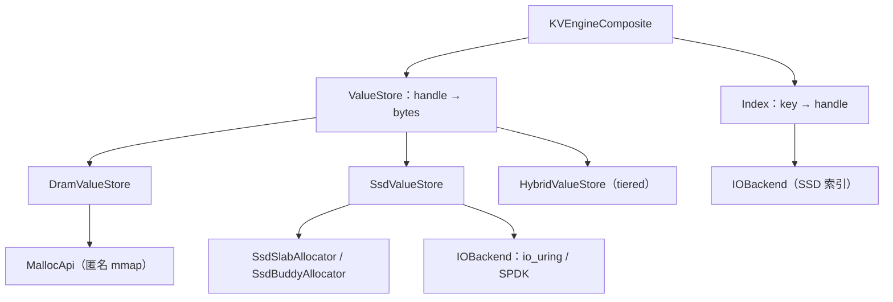

# RecStore 存储层技术报告

## 1. 接口

存储层给参数服务器提供 `uint64_t key -> value 字节` 的本地 KV 语义，接口是 `BaseKV`（`src/storage/kv_engine/base_kv.h`）。`CachePS` 只依赖 `BaseKV`，用 `base::ResolveEngine` 解析 `engine_type` 后交给工厂：

```cpp
BaseKVConfig kv_config;
kv_config.num_threads_ = config["num_threads"];
kv_config.json_config_ = config["base_kv_config"];
auto resolved = base::ResolveEngine(kv_config);
base_kv_.reset(base::Factory<BaseKV, const BaseKVConfig&>::NewInstance(
    resolved.engine, resolved.cfg));
```

`ResolveEngine`（`engine_selector.h`）读取 `engine_type`（缺省 `KVEngineComposite`），名称必须落在 `{KVEngineComposite, KVEnginePetKV, KVEngineDETable, KVEngineFasterKV, KVEngineHPSHashMap, KVEngineHPSRocksDB}` 内，否则抛 `invalid_argument`。`index` / `value` 嵌套字段由各引擎和组件的构造函数校验，配错时在构造阶段抛异常。

`BaseKV` 的方法约定：

| 方法 | 语义 |
|------|------|
| `Get(key, std::string&, tid)` | 命中写入 value；未命中清空 value |
| `Put(key, string_view, tid)` | 变长写入；`KVEngineComposite` 支持，FasterKV / HPS 常要求固定 `value_size` |
| `BatchGet(keys, vector<ConstArray<float>>*, tid)` | 未命中项为空数组；DRAM 返回指向底层存储的零拷贝视图 |
| `BatchPut(keys, vector<ConstArray<float>>*, tid)` | 批量写入 |
| `BatchGetFlat(keys, float*, num_rows, dim, tid, stats)` | 按 `[num_rows, dim]` 连续行填充；返回 `bool` 表示是否支持 |
| `BatchGetDirectFixedRows(...)` | 返回指向 DRAM slot 的固定宽度行视图 |
| `ApplySgdUpdateFlat(...)` | 稀疏 SGD 就地更新；返回 `bool` |
| `BulkLoad(keys, value)` | 定长批量装载，依赖 `default_value_size_hint` |
| `SaveCheckpoint` / `LoadCheckpoint` | 全量导出 / 导入 |
| `GetRDMABackingRegion()` | 暴露可注册 RDMA 的底层区域（DRAM 值区） |

`tid` 由调用方传入，`KVEngineComposite` 只在 checkpoint 的按线程 key 记录中用它，索引和值存储靠内部同步。`tid` 必须落在 `[0, num_threads_)`，越界时 `CheckpointKeysForThread` 触发 `LOG(FATAL)`。

## 2. KVEngineComposite 的组织



`KVEngineComposite` 用 `Factory<Index>` 和 `Factory<ValueStore>` 分别构造两个组件，读写逻辑都在这一层：

- 写：`value_store_->AllocAndWrite` 分配并写入新 slot，`index_->Put` 换入新 handle 并返回旧 handle，再对旧 handle 调用 `Retire`。
- 读：`index_->BatchGet` / `Get` 解析 handle，命中后优先 `DirectPtr` 返回视图，否则 `Read` / `BatchRead` 拷贝到线程局部缓冲。

`index` 与 `value` 独立组合，组合约束见 `docs/storage/composite_kvengine.md`。`handle` 是 `uint64_t`，`0` 恒为 `NONE`（未命中）；各值存储的 handle 编码在第 4 节。

## 3. 索引实现与布局

索引只存 `key -> handle`，不存 value。`Pair` 为 `{uint64_t key, uint64_t value}`，共 16 B；未使用槽位用 `INVALID = -1`，删除标记用 `SENTINEL = -2`。

### 3.1 DRAM_PET_HASH（默认）

`base::PetHash<Key_t, Value_t, false>`（`src/storage/nvm/pet_kv/pet_hash.h`），结构参考 Folly F14。

- 哈希表是长度为 2 的幂的 `F14Chunk` 数组。每个 `F14Chunk` 有 14 个槽位、一一对应的 1 B tag 数组（`tags_[14]`）、`size_`、`overflow_count_`、`is_migrating`，以及一个 `base::Lock`（内含 `std::mutex`，8 B 对齐，40 B）。
- 槽位本体 `EntryT<Key_t, Value_t>` 用 `#pragma pack(2)` 打包，16 B。按字段布局 `F14Chunk` 为 282 B，按 `__aligned__(64)` 取整后是 **320 B / 14 槽**，即 22.9 B/槽的索引载荷。
- 每键实际开销还要算上容量取整：`capacity /= 0.9` 后 `chunk_num = Next2Power(capacity / 14)`，`capacity_ = chunk_num * 14`。`record_count = 1e6` 时 `chunk_num = 131072`，索引约 `131072 * 320 = 40 MiB`，即 41.9 B/键。
- chunk 下标取低 `log2(chunk_num)` 位；tag 取 `crc32c(hash)` 的高 8 位并置最高位（`kSignBit = 8`），因此 tag 非 0，与空槽的 tag 0 区分，探测步长为 `tag * 2 | 1`。查找用 SSE2 `_mm_cmpeq_epi8` 对 14 个 tag 并行匹配，命中后再比对完整 key。`BatchGet` 在读取第 i 个键之前对第 i+1 个键调用 `HintPrefetch`，把 chunk 头部与首个槽位预取进 L1。
- 冲突用带上界的线性探测，步长由 tag 派生；`overflow_count_` 为 0 时提前终止探测，发生过溢出的 chunk 继续探测下一个。
- 并发上，插入/删除持有 chunk 锁，`size_`、`overflow_count_`、`is_migrating` 为原子量。`Persistence=false` 时不执行 `clflushopt`。

4 个桶时，键 4、8、12、16、20 的哈希低位都是 00，落在同一 chunk；键 5 与 17 的低位都是 01，落在另一 chunk，且 tag 同为 224。插入 17 时标签比较只会给出候选槽，槽内键是 5 与 17 不等，必须再找空槽写入；tag 只做筛选，最终判定靠完整 key。

### 3.2 DRAM_EXTENDIBLE_HASH

`ExtendibleHash`（`src/storage/index/dram/extendible_hash.h`）是 LSB 可扩展哈希。

- `Block` 的 `kBlockSize = 256`，`kNumSlot = kBlockSize / sizeof(Pair) = 16`，每个 block 16 个槽、256 B 载荷，外加 `local_depth`、`sema`、`pattern` 共 24 B；`operator new` 用 `posix_memalign(64)`，实际占约 320 B / 16 槽。
- `Directory` 默认 1024 个 `Block*`（8 KiB）。`local_depth == global_depth` 时目录翻倍，`LSBUpdate` 复制指针；查找用 `key_hash & (2^global_depth - 1)` 取目录下标，低位扩展与 `#define LSB` 一致。
- 并发用每 block 的 `sema`（CAS 自旋）保证分裂与插入的独占。
- 分裂后 block 平均填充约一半，每键索引开销高于 PET hash（见 8.4）。

4 项目录时，16 个哈希低位为 00 的键填满 `dir[0]` 的 block 后，插入第 17 个触发分裂：全局深度 2→3，目录翻倍到 8 项，`dir[0]` 与 `dir[4]` 分别指向两个局部深度 3 的新 block，其余三项通过 `dir[i]` 与 `dir[i+4]` 共享旧 block。

### 3.3 DRAM_UNORDERED_MAP

`std::unordered_map<uint64_t, uint64_t>` 加一把进程内 `std::shared_mutex`（`src/storage/index/dram/unordered_map_index.h`）。读取共享锁、写取独占锁。实现简单，所有操作竞争同一把锁；桶链表与节点分配带来额外内存开销。

13 个桶时，键 10 与 23 同落桶 10，查询 23 需在链上先比较 10 再比较 23；写入取独占锁，装载因子超过 1.0 时重建桶数组。

### 3.4 索引对比

| `index.type` | 结构 | 单键索引开销 | 同步 | 状态 |
|---|---|---|---|---|
| `DRAM_PET_HASH` | 2 的幂 chunk × 14 槽，tag + 线性探测 | 41.9 B/键（1e6） | 每 chunk 锁 + 原子计数 | 默认 |
| `DRAM_EXTENDIBLE_HASH` | 16 槽 block + 可翻倍目录 | 实测约 78 B/键 | 每 block 自旋锁 | 可用 |
| `DRAM_UNORDERED_MAP` | 桶链表 | 实测约 54 B/键 | 全局读写锁 | 可用 |

## 4. 值存储在内存与 SSD 上的布局

`ValueStore` 接口是 `Alloc / Write / Read / Free / SlotCapacity`，另有可选的 `DirectPtr` 与批量路径（`value_store.h`），`handle` 由各实现定义。

### 4.1 DRAM_VALUE_STORE

`DramValueStore` 建在 `MallocApi` 上：`handle = offset + 1`，`offset` 是分配器基址内的字节偏移，`handle == 0` 表示 `NONE`。

- `Alloc` 调 `allocator_->New(size)`，返回 `GetMallocOffset(data) + 1`。`Write` / `Read` 通过 `GetMallocData(offset)` 直接 `memcpy`，`SlotCapacity` 取 allocator 记录的分配大小。
- 数据在进程地址空间内，`DirectPtr` 返回真实指针，`BatchGet` / `BatchGetFlat` 返回 `ConstArray<float>` 零拷贝视图；`RDMABackingData/Size` 暴露整块区域供 RDMA 注册（`GetRDMABackingRegion`）。
- 默认分配器 `CONCURRENT_SLAB_MEMORY_POOL`（`memory/allocators/concurrent_slab_memory_pool.h`）：
  - 区域按 1 MiB chunk 切分，chunk 数 = `floor(capacity_bytes / 1 MiB)`。
  - 每个 chunk 绑定一个 slab 尺寸后不再改绑；尺寸类固定为 `{40, 72, 136, 520, 1032}`（8 B 元数据 + 最大 32 / 64 / 128 / 512 / 1024 B 载荷）。`New(memory_size)` 取 `lower_bound(8 + memory_size)`，在载荷前 4 B 写入实际长度；元数据窗口取 8 B 而非 4 B，是为了让槽大小与载荷偏移都落在 8 字节边界（`GetMallocOffset` 断言 `offset % 8 == 0`）。
  - 每个 chunk 用 64 位字位图分配空闲槽（`TryAllocFromBitmap` 的 CAS），线程内缓存一个 "hot" chunk，跨 chunk 从全局空闲池取。
  - DRAM 值最大长度因此为 1024 B。
  - 例：100 B value 取 136 档；槽布局 `[4 B size | 4 B pad | 100 B data | 28 B slack]`。槽偏移 `0x00123420` 对应 `handle = 0x00123421`，`Read` 用 `GetMallocData(handle - 1)` 直接 `memcpy`。
- `PERSIST_LOOP_SLAB` 与 `R2_SLAB` 共用同一 `MallocApi` 接口。`PersistLoopShmMalloc` 用固定 slab 尺寸与循环 bump 指针；`R2alloc` 用空闲表管理固定尺寸的块。
- DRAM 介质下分配器采用 `ShmFile::ConfigForMedium("DRAM", ...)` 的 `ANONY_DRAM` 分支，即 `mmap(MAP_PRIVATE | MAP_ANONYMOUS)`，`value.path` 字段留空；`ConcurrentSlabMemoryPool` 每次启动重建区域。DRAM 值区随进程生命周期，恢复依赖 `SaveCheckpoint`（见 6.4）。
- `ShmFile` 的 `munmap` 在析构时执行。

### 4.2 写入即复制（COW）与延迟回收

`PutInternal` 的固定顺序是：分配新 slot → 写值 → `index_->Put` 换 handle → `Retire(old_handle)`。写入采用 COW：新值进入新 slot，旧 slot 通过 `ThreadSafeDelayedRecycle` 延迟 `kRecycleDelayUs = 1000`（1 ms）后释放；`DirectPtr` 视图的有效期覆盖这 1 ms 回收窗口。

`ApplySgdUpdateFlat` 是例外：它在 DRAM 上通过 `BatchGetDirectFixedRows` 取到行指针后直接 `value[c] -= lr * grad[c]` 就地更新（见 6.3）。

### 4.3 SSD_VALUE_STORE

`SsdValueStore` 组合一个 `SsdBlockAllocator`（`SSD_SLAB` 或 `SSD_BUDDY`）与一个 `IOBackend`。`handle` 就是分配器 handle，读路径统一经 `IOBackend`。

IO 以 4 KiB 页为单位，文件以 `O_DIRECT` 打开（`IoUringBackend::init`），`value.path` 映射为 `file_path`。IOBackend 的 `page_id_offset` 取 `io.base_offset_bytes / PAGE_SIZE`；slab / buddy 分配器的基址取 `ssd_allocator.base_offset_bytes`。样例配置把该字段放在 `io` 内，分配器基址为 0。

**SSD_SLAB**（默认，`ssd_slab_allocator.h`）：

- 区域按 `kBlockSize = 1 << 26`（64 MiB）切块，启动时把所有块的字节偏移压入 `global_free_blocks_`。
- 尺寸类默认 `{128, 256, 512, 1024, 4096}`，`slab_idx` 是该表的 0 基下标（0→128 … 4→4096），不是字节数。每个 slab 槽 = 4 B 头（存实际数据长度）+ 尺寸类字节，槽实际占用 `size_class + 4`。长度头取 4 B：载荷经页缓冲 `memcpy` 拷出或写入，不要求对齐。64 MiB 块内槽按 `slot_size` 紧密排列，`slots_per_block = floor(64 MiB / slot_size)`。
- `handle` 编码为 `(uint16 slab_idx << 48) | ((local_slot_id + 1) & 0xFFFF_FFFF_FFFF)`；解码得到 slab 与块内槽号，再折算 `block_idx = local / slots_per_block`、`slot_in_block = local % slots_per_block`，字节偏移 = `block.byte_offset + slot_in_block * slot_size`。
  - 例：100 B value → `SelectSlab` 命中 128 档，槽 132 B；3 号块第 5 槽 → `local_slot_id = 3 * 508400 + 5 = 1525205`，`handle = (0 << 48) | 1525206`；`ResolveSlotByteOffset` 得 `3 * 64 MiB + 5 * 132`，再按 `/ PAGE_SIZE` 与 `% PAGE_SIZE` 拆出页号与页内偏移。
- 块状态为 `cursor`（下一个未用槽）、`free_in_block`（释放回收的槽）、`used_count`。块从 `partial_blocks` 取用，用满后移出；`used_count` 归零后置 tombstone 并把字节偏移还回全局池，后续可重新绑定尺寸类。
- 单键 `Write` 是读-改-写：读入该槽所在页，写 4 B 长度与数据，再写回该页。槽紧密排列，跨页的槽需要读写 2 个页（约 1/32 的槽跨页）。
- 批量路径：`BatchAllocAndWrite` 按 `(start_page, pages)` 合并同一页内的多个写入，先批量读、同页内合并补丁、再批量写；`BatchRead` 为每条记录分配 IO buffer，一次 `BatchReadPages` 提交。
- 单键 `Write` 的读-改-写只有 slab 槽位计数锁，没有页级锁，这是 8.5 并发丢更新的根因。

**SSD_BUDDY**（`ssd_buddy_allocator.h`）：

- 块尺寸是 2 的幂 `min_block_size << level`，`level` 覆盖 `[min_block_size, max_block_size]`，每级一个空闲集合（`unordered_set`，按块地址索引）。
- 每块头部 8 B：4 B 数据长度 + 4 B level。分配时从目标级向上找第一个非空级，向下对半切分；释放时按 buddy 地址异或合并。
- `handle` 是块号（以 min block 为单位），字节偏移 = `base_offset + block_addr * min_block_size`。`Read` / `Write` / `ReadHeader` 在同一把全局 `io_mu_` 下串行执行，写入互斥，代价是所有 SSD IO 串行。
- `SlotCapacity = (min_block_size << level) - 8`。

单键 `Get` 经 `SsdValueStore::Read` → `SsdSlabAllocator::ReadBytes`，一次同步提交并等待；`BatchGet`（以及 tiered 的 SSD 命中）经 `BatchRead`，按 `(start, pages)` 分组后一次提交，在途窗口由 `queue_cnt` 决定。单键路径每次发出一个在途 IO，吞吐由该路径延迟决定；`BatchGet` 使用 `queue_cnt/2` 的窗口（见 8.3）。

### 4.4 TIERED_VALUE_STORE

`HybridValueStore` 组合一个 `DramValueStore` 与一个 `SsdValueStore`，`handle` 最高位是介质标记：`handle & (1ULL << 63)` 为 1 表示 SSD，其余位是子存储的 handle。

- `Alloc(size)`：若 `(dram_bytes_reserved_ + size) / dram_capacity_bytes_ <= high_watermark_ratio_`（默认 0.85）则尝试 DRAM，DRAM 分配失败则回退 SSD，否则直接 SSD。决策在分配时做一次。
- `dram_bytes_reserved_` 只统计 DRAM slot 的 `SlotCapacity`，在 `Free` 时递减；`ExtraResultFields` 输出 `tiered_dram_live_allocs` / `tiered_ssd_live_allocs` / `tiered_ssd_live_ratio` 等计数器。
- `DirectPtr` 返回 DRAM 侧指针，`RDMABacking*` 也透传 DRAM 侧。
- 分层由 `high_watermark_ratio` 控制。
- `dram_capacity_bytes_` 取配置值，而 `CONCURRENT_SLAB_MEMORY_POOL` 的实际可用容量是 `floor(capacity / 1 MiB) * 1 MiB`。当 `0.85 * 配置值 > 实际可用` 时 DRAM 侧 OOM（见 8.5）。

## 5. IO 后端

`IOBackend`（`io_backend.h`）以页（`PAGE_SIZE = 4096`）为单位，接口包括 `ReadPageSync/Async`、`WritePageSync/Async`、`GetPage/Unpin`、`AllocateBuffer`、`BatchReadPages/BatchWritePages`、`submit/PollCompletion`、`AllocatePage`。后端按类型名注册到工厂；`SsdValueStore` 从 `value.io` 读取 `type`（默认 `IOURING`）、`queue_depth`（默认 512）与 `base_offset_bytes`。两者共用同一套页接口与批量窗口；固态盘值存储与页号分配都经由它，不直接做文件或设备 IO。内存侧走 `MallocApi` 与直接访存。

- `IoUringBackend`：`O_DIRECT` 打开文件；每个线程一份 thread-local `io_uring`，队列深度来自 `queue_cnt`（配置 `io.queue_depth`，默认 512）。`next_page_id` 在 `init` 时按文件大小初始化，复用文件时从文件末尾续写。
- 同步单页读写用 `io_uring_submit_and_wait(1)` + `wait_cqe`。异步路径把 `user_data` 当作协程下标，`PollCompletion` 用 `io_uring_peek_cqe` 取完成事件并恢复对应协程。
- `BatchReadPages` / `BatchWritePages` 用滑动窗口：在途上限 `max(queue_cnt / 2, 1)`，每个 `IOEntry` 可覆盖多页，一次 `io_uring_prep_read/write` 提交一段连续区间，每轮忙轮询 `io_uring_peek_cqe` 收割。
- `SpdkBackend`：用户态 NVMe 驱动。`init` 按 PCIe 地址 `0000:c2:00.0` 探测控制器并选取首个活跃 namespace；环境与控制器在进程内共享，`instance_count_` 归零后统一释放线程 qpair。每个线程一个 qpair（`io_queue_size = queue_cnt + 1`），提交隐含在 `spdk_nvme_ns_cmd_read/write` 内，`PollCompletion` 调 `spdk_nvme_qpair_process_completions` 轮询完成。IO 缓冲来自 `spdk_zmalloc(..., SPDK_MALLOC_DMA)`，`FreeBuffer` 用 `spdk_free`。
- `SpdkBackend` 由 `RECSTORE_ENABLE_SPDK` 构建开关控制（默认关闭）；后端经 `ForceLinkIOBackends` 显式链接到二进制，配置的类型名缺注册时工厂报 `no Factory instance`。

## 6. 读写、批量与优化器语义

### 6.1 单条与批量写

`Put` 与 `BatchPut` 都先取 `checkpoint_mu_` 的共享锁（与 checkpoint 的独占锁互斥）。`BatchPut` 先做批内重复 key 检测：重复 key 逐条 `PutInternal`，同一 key 只分配一次；其余经 `value_store_->BatchAllocAndWrite` 一次性分配，再逐个 `index_->Put` 并 `Retire` 旧 handle。

### 6.2 单条与批量读

`Get` 先 `index_->Get`，`DirectPtr` 非空时按 `SlotCapacity` 拷贝，否则 `Read` 到 `SlotCapacity` 大小的缓冲并按实际返回长度收缩。DRAM 路径按 slot 容量返回长度：`CONCURRENT_SLAB_MEMORY_POOL` 的 slot 容量等于请求长度（长度放在单独的头里），`PersistLoopShmMalloc` 等定长 slab 返回 slab 大小。

`BatchGet` 先 `index_->BatchGet` 得到 handle 数组，命中且 `DirectPtr` 可用的直接构造视图，其余收集为一批交给 `value_store_->BatchRead`，SSD 侧按 1024 条上限分组提交。

### 6.3 扁平读与就地稀疏更新

- `BatchGetFlat` 在 DRAM 上使用快速路径：`default_value_size_hint == embedding_dim * 4` 且 `ValueStore::ReadFlatFixedRows` 可用（`DramValueStore` 已实现），一次索引批量查找后连续填充 `[num_rows, dim]`。
- `BatchGetDirectFixedRows` 返回指向 DRAM slot 的行视图。
- `ApplySgdUpdateFlat` 把 8 位 tag 写进 key 高位（`(tag << 56) | (key & 0x00FF_FFFF_FFFF_FFFF)`），再调 `BatchGetDirectFixedRows`。命中行就地做 `row[c] -= lr * grad[c]`；未命中行为 `-lr * grad` 并 `PutInternal`。整个方法在 `checkpoint_mu_` 共享锁下执行，要求 DRAM 且 `default_value_size_hint == row_bytes`。
- `BulkLoad` 按 `default_value_size_hint` 定长切分输入，经 `value_store_->BatchAllocAndWrite` + `index_->BatchPut`。

### 6.4 Checkpoint

`SaveCheckpoint` 的流程：

- 每个线程在 `PutInternal` 成功后把 key 追加到 `checkpoint_keys_by_thread_[tid]`，`CollectCheckpointKeys` 合并所有线程的记录、排序、去重。
- 写盘持 `checkpoint_mu_` 独占锁，阻塞写入，逐条 `Get` 后序列化。
- 文件格式：magic `RSKVCP01`（8 B）+ `version = 2`（4 B）+ `metadata_size`（8 B）+ `record_count`（8 B）+ metadata + `record_count` 组 `(key, value_size, value)` + 末尾 `xxhash` 校验和（种子 `0x9e3779b97f4a7c15`）。
- 先写 `.tmp` 再 `rename`。`LoadCheckpoint` 校验引擎为空、metadata 相等、校验和匹配、文件止于校验和，然后逐条 `PutInternal` 恢复。
- 只重建被跟踪的 key；DRAM 值区是匿名映射，进程重启后从 checkpoint 重建是唯一的恢复路径。

## 7. 其他存储引擎

- `KVEnginePetKV`：`base::PetMultiKV` + `PetHash<uint64, PetKVData, true>` + 共享内存分配器，按 key 分片（默认 16 片）。值区用 `PetKVData` 打包 `shm_malloc_offset`（左移 3 位）与 32 位过期时间；`BatchGet` 也可使用带预取的 `PetMultiKV::BatchGet`（gflag `prefetch_method=1`）。`RegisterPMAddr` 返回 RDMA 内存区，`value_capacity` 必填。
- `KVEngineFasterKV`：Microsoft FASTER 的适配（`external/fasterkv/`），支持内存或 SSD 日志、可配 hybrid log 内存、mutable fraction、read cache；`value_size` 固定。
- `KVEngineHPSHashMap` / `KVEngineHPSRocksDB`：HugeCTR HPS 适配（`external/hps/`），前者纯内存哈希，后者 RocksDB 落盘，`path` 必填。
- `KVEngineDETable`：`external/detable/` 的动态 KV 插件适配。

## 8. 实测

### 8.1 环境与方法

- 数据于 2026-10-11 采集，脚本与原始日志在 `results/storage_report_10111849/`（索引、SSD、内存矩阵）和 `results/storage_report_verify_10112039/`（SSD 并发丢更新复现）。
- 运行环境：18 vCPU（容器），92 GiB 内存，`/dev/shm = 2 GiB`；SSD 路径为 `/tmp` 所在的 `md0p1`（3 块 894 GB NVMe 组 RAID0）；内核 5.10；`io_uring` + `O_DIRECT`。
- 工具：`build/bin/benchmark_kv_engine`（Release，`build/` 配置为 `CMAKE_BUILD_TYPE=Release`）。
- 参数：`value_size=128`（32 个 float），`read_mode=get`，`running_seconds=3–5`。DRAM 索引矩阵每配置 3 次取均值，线程扩展、批量路径与 SSD 组各 1 次。SSD 组单线程装载，`record_count=200000`。
- `ops` 计 KV 操作数；表格均用 `read_mode=get`。

### 8.2 DRAM 索引组合（1e6 记录，16 线程）

workload c（100% 读）、`read_mode=get`，单位 M ops/s：

| index | uniform | zipfian(0.9) | load uniform | load zipfian |
|---|---:|---:|---:|---:|
| DRAM_PET_HASH | 42.29 | 58.69 | 4.96 | 4.42 |
| DRAM_EXTENDIBLE_HASH | 18.09 | 23.02 | 1.65 | 1.63 |
| DRAM_UNORDERED_MAP | 10.32 | 10.84 | 1.22 | 1.20 |

workload a（50% 读 / 50% 写），单位 M ops/s：

| index | uniform | zipfian(0.9) |
|---|---:|---:|
| DRAM_PET_HASH | 4.963 | 4.842 |
| DRAM_EXTENDIBLE_HASH | 4.640 | 4.463 |
| DRAM_UNORDERED_MAP | 0.445 | 0.532 |

- 读性能与索引结构一致：SIMD tag 匹配 + 提前终止探测的 PET hash 比可扩展哈希快 2.3 倍，比全局读写锁保护的 `unordered_map` 快约 4 倍。zipfian 下三者都受益于缓存局部性，PET hash 提升最多（+39%）。
- workload a 下 PET hash 与可扩展哈希收敛到 4.4–5.0 M ops/s，写路径被 `AllocAndWrite` + 延迟回收 + 索引换 handle 主导；`unordered_map` 降到 0.45 M（uniform），写独占锁与读共享锁争用同一把锁，1e6 规模下桶结构与重哈希开销也更大。

### 8.3 线程扩展与批量路径（1e6 记录）

`read_mode=get`、workload c、uniform，单位 M ops/s：

| 线程 | PET | EH | UM |
|---:|---:|---:|---:|
| 1 | 3.28 | 2.57 | 2.40 |
| 2 | 5.30 | 4.19 | 2.96 |
| 4 | 12.14 | 8.92 | 6.21 |
| 8 | 22.45 | 12.04 | 8.32 |
| 16 | 42.87 | 18.12 | 10.32 |
| 32 | 46.78 | 18.81 | 10.41 |

DRAM 上 `get` 与 `batch_get_flat`（`batch_keys=500`）对比（16 线程）：`get` 41.77 M，`batch_get_flat` 100.64 M（2.4×）。后者一次索引批量查找 + 连续行填充，省去逐条调用的固定开销。

SSD（`SSD_SLAB`，`record_count=200000`，单线程装载，`queue_depth=512`）：

| 线程 | 1 | 2 | 4 | 8 | 16 | 32 |
|---|---:|---:|---:|---:|---:|---:|
| ops/s | 9 032 | 20 499 | 39 351 | 73 691 | 114 523 | 103 722 |

- 16 线程饱和在约 1.1e5 ops/s，每线程约 7 000 ops/s、单次读取约 140 µs，这是单键同步读的延迟瓶颈。
- `queue_depth` 在 1 / 32 / 512 下为 114 736 / 120 708 / 113 638 ops/s：单键 `Get` 每次挂一个在途 IO，吞吐由该路径延迟决定；`BatchGet` 按 `queue_cnt/2` 的窗口提交多页 IO。

### 8.4 内存占用（2e6 记录，装载阶段）

峰值内存用轮询 `/proc/<pid>/status` 的 `VmHWM` 采集。值区 slab 每键固定 136 B（128 B 载荷 + 8 B 头），从两次测量（1e6 与 2e6）的斜率中减去该值得到索引开销：

| index | VmHWM @1e6 | VmHWM @2e6 | 斜率 / 键 | 减 136 B 后 |
|---|---:|---:|---:|---:|
| DRAM_PET_HASH | 201 172 KB | 385 472 KB | 188.6 B | 52.6 B |
| DRAM_EXTENDIBLE_HASH | 231 524 KB | 445 300 KB | 213.8 B | 77.8 B |
| DRAM_UNORDERED_MAP | 202 964 KB | 392 500 KB | 189.5 B | 53.5 B |

PET hash 的 52.6 B/键与代码推导一致：1e6 记录时 `chunk_num = 131072`、`sizeof(F14Chunk) = 320`，合计约 40 MiB ≈ 41.9 B/键。斜率含 allocator 元数据、线程栈与 arena，高于纯索引开销。可扩展哈希因 block 分裂留下半空 block，每键开销最高；`unordered_map` 的节点与桶开销居中。

### 8.5 并发正确性与容量边界

1. **SSD_SLAB 单键写在并发装载下丢更新。** 单键 `Write` 对同一页做读-改-写，页内并发写互相覆盖。1e6 记录、16 装载线程时，`read_mode=batch_get_flat` 报出 `actual_bytes=0` 的行（长度头被覆盖）。缩小规模复现：

   | 装载线程 | 读线程 | batch_keys | 记录数 | 不匹配行 |
   |---:|---:|---:|---:|---:|
   | 1 | 16 | 16 | 20 000 | 0 |
   | 16 | 16 | 16 | 20 000 | 12 |
   | 1 | 4 | 4 | 20 000 | 0 |
   | 4 | 4 | 4 | 20 000 | 4 |

   相邻槽落在同一 4 KiB 页时互相覆盖；`SSD_BUDDY` 的全局 `io_mu_` 串行化 IO。8.3 的 SSD 数据用单线程装载。

2. **tiered 在多线程装载下偶发分配失败。** 1e6 记录、16 装载线程的 tiered 配置多次运行中偶发 `KVEngine value allocation failed, key=...`，`PutInternal` 在 `AllocAndWrite` 返回 `NONE` 后 `LOG(FATAL)`；单线程装载稳定通过。

3. **tiered 的 DRAM 容量口径不一致会直接 OOM。** tiered 下 DRAM 容量取 `value_capacity` 的 10%。`record_count=300000` 时配置约 4.9 MB，而 `CONCURRENT_SLAB_MEMORY_POOL` 实际可用为 `floor(4.9 MB / 1 MiB) * 1 MiB = 4 MB`；高水位按 0.85 × 4.9 ≈ 4.17 MB 放行，池在约 4.18 MB 处 `ConcurrentSlabMemoryPool OOM`。

4. **DRAM 值长度上限 1024 B。** 默认尺寸类最大到 1032（1024 B 载荷），`value_size=2048` 时 `New` 的 `lower_bound` 直接 `CHECK` 失败。

### 8.6 验证

| 测试 | 结果 |
|---|---|
| `test_ssd_allocators` | 14/14 通过（含 slab/buddy 边界与 tombstone 复用；单线程） |
| `test_kvengine_checkpoint` | 3/3 通过（含 metadata 不匹配与损坏文件拒绝） |
| `test_kvengine`（`KVEngineFlatReadTest` / `KVEngineNestedConfigTest` / `KVEngineCompositeConfigTest`） | 6/6 通过 |

## 9. 结论

- `KVEngineComposite` 把索引与值存储解耦：索引承担 `key -> handle`，值存储承担 `handle -> bytes`，两层的 handle 编码、介质与线程模型各自独立。解耦使同一套默认引擎同时覆盖 DRAM、SSD 与 tiered。
- 默认组合 `DRAM_PET_HASH + DRAM_VALUE_STORE + CONCURRENT_SLAB_MEMORY_POOL` 的读性能由 PetHash 的 SIMD tag 匹配与提前终止探测决定，写性能由 COW + 1 ms 延迟回收决定。workload a 下 PET hash 与可扩展哈希收敛到 4.5–5.0 M ops/s，索引差异被写路径摊平；`unordered_map` 因全局锁降到 0.45 M。
- DRAM 路径提供零拷贝视图、RDMA 可注册值区与 `batch_get_flat` 连续填充：1e6 记录、16 线程下 `get` 41.77 M ops/s，`batch_get_flat` 100.64 M ops/s（2.4×）。
- SSD 路径以 4 KiB 页为最小 IO 单位、`O_DIRECT` 直读直写，单键路径是同步单在途 IO、延迟受限，批量路径通过 `queue_cnt/2` 的滑动窗口获得并发。
- 本次测量暴露的问题：`SSD_SLAB` 单键并发写丢更新；tiered 的 DRAM 容量口径不一致与多线程分配失败；DRAM 值长度上限 1024 B。前两项影响 SSD / tiered 值存储在并发装载下的正确性。
